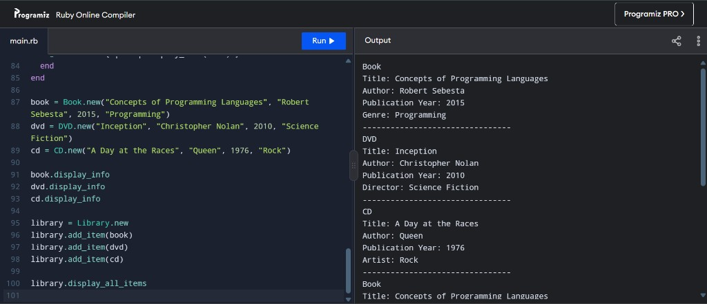

# Task 3 — Library catalog

`library.rb` is a small catalog of books, DVDs, and CDs. One base class holds the fields every item shares. Three subclasses add the field that belongs to that kind of item. `Library` stores the items and prints them without checking which subclass each one is.

## Classes

`LibraryItem` stores `title`, `author`, and `publication_year`. `attr_reader` exposes those values for reading and leaves the instance variables inside the class. `display_info` prints the three shared fields.

`Book`, `DVD`, and `CD` inherit from `LibraryItem`.

| Class | Extra property | Printed label |
| --- | --- | --- |
| `Book` | `genre` | Genre |
| `DVD` | `director` | Director |
| `CD` | `artist` | Artist |

Each subclass calls `super` in `initialize` to store the shared fields, then stores its own field. `display_info` prints the item type, calls `super` to print the shared fields, then prints the extra field.

`Library` keeps the items in `@items`.

- `add_item` appends an item.
- `remove_item` deletes that same object from the collection.
- `display_item` calls `display_info` on whatever object it receives.
- `display_all_items` walks the collection and calls `display_item` for each entry.

## Polymorphism

`display_item` accepts any library item. A book, a DVD, and a CD are all passed to that one method. Ruby runs `Book.display_info`, `DVD.display_info`, or `CD.display_info` according to the object's class, so each item prints its own extra field. `display_all_items` uses that same method for every entry in `@items`.

## Run

The bottom of `library.rb` builds the three sample items, prints each one, adds them to a library, and prints the catalog again.

Note: AI tools were used to assist with the preparation of the technical documentation.